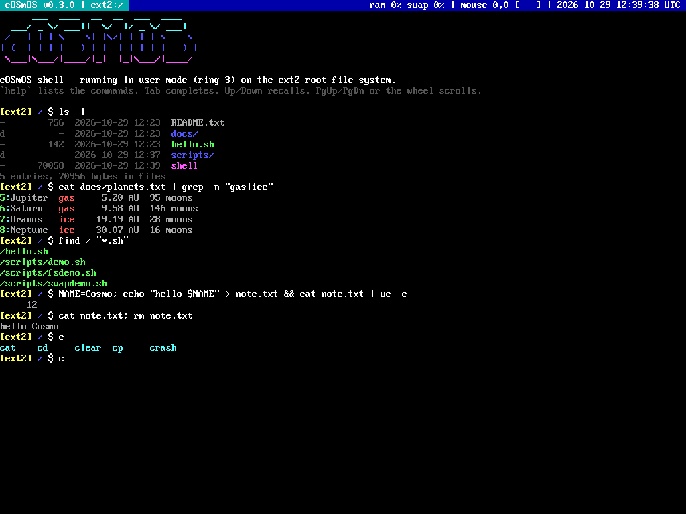
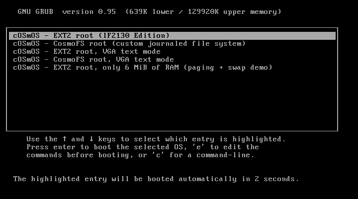
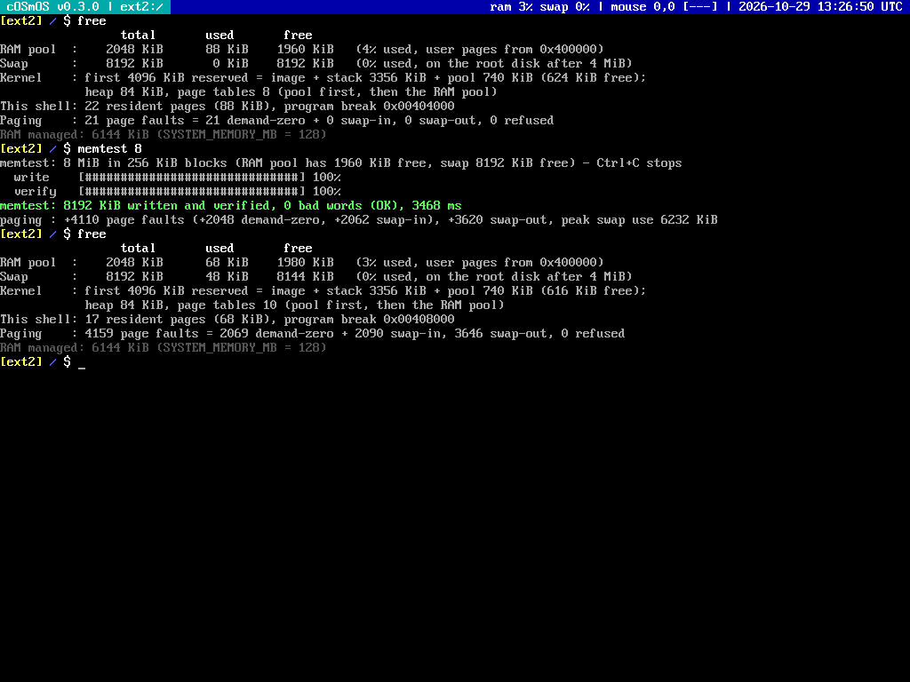
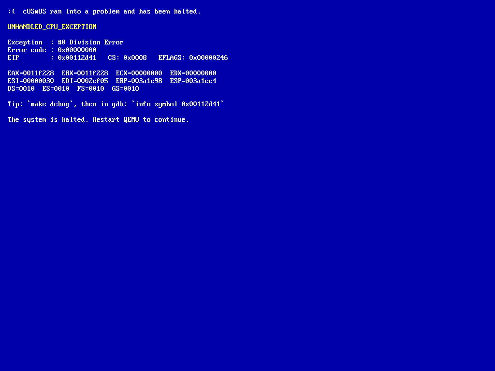
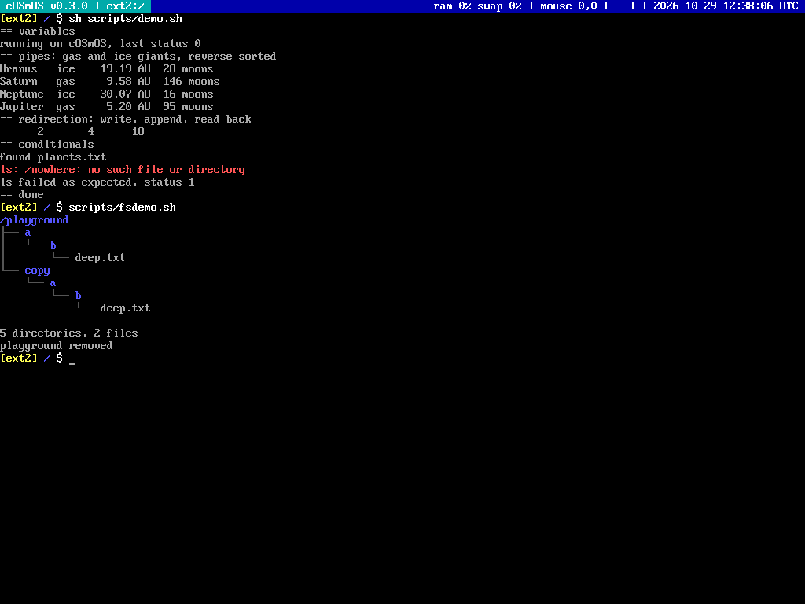
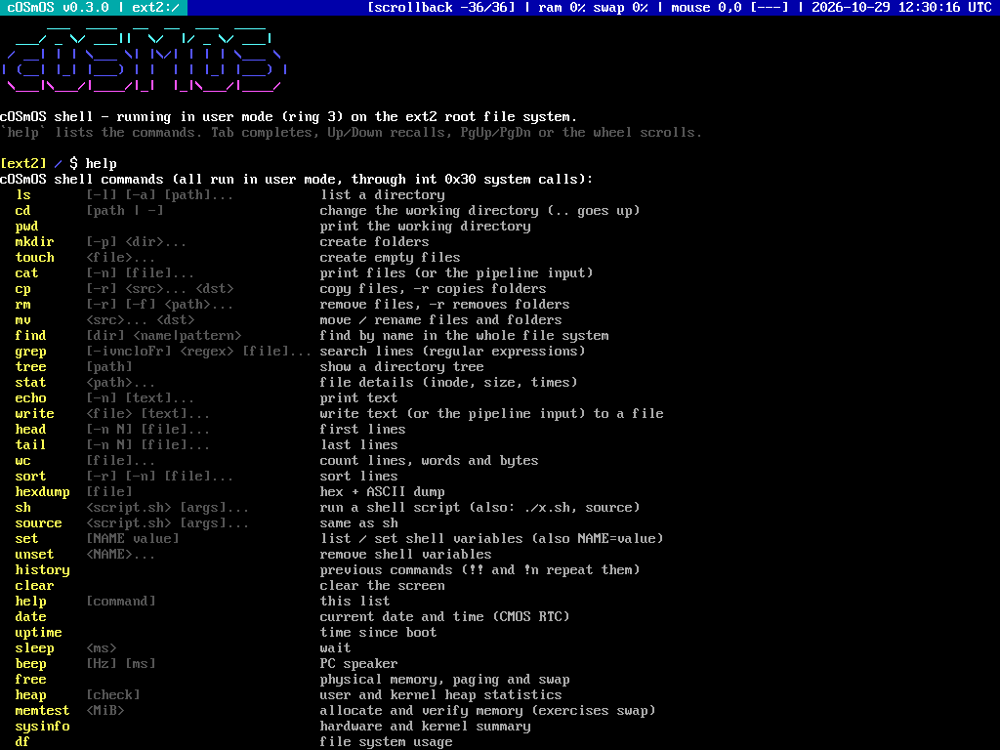
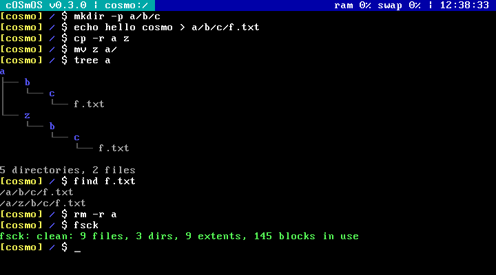
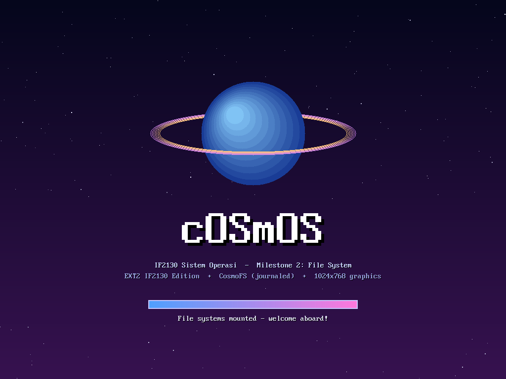

<p align="center">
  
</p>

<h1 align="center">cOSmOS</h1>

<p align="center">
  Sistem operasi x86 32-bit (protected mode) untuk Tugas Besar IF2130 Sistem Operasi 2026/2027.<br>
  Release saat ini: <b>v0.3.0 - Milestone 3 (Paging, Swap, User Mode, Shell)</b>
</p>



## Nama Kelompok

**cOSmOS**

| Anggota (GitHub) | Nama | NIM |
| --- | --- | --- |
| [@FahrezyyF](https://github.com/FahrezyyF) | Fahrezy Fitriansyah | 13525072 |
| [@TheProfessorDuck](https://github.com/TheProfessorDuck) | Christian Immanuel | 13525116 |
| [@ZelosoleZW](https://github.com/ZelosoleZW) | Denzel Santoso | 13525014 |
| [@i-jer](https://github.com/i-jer) | Jeremy Gerald Sutanto | 13525104 |

## Daftar Isi

- [Nama Kelompok](#nama-kelompok)
- [Cara Run](#cara-run)
  - [Prasyarat](#prasyarat)
  - [Build dan menjalankan OS](#build-dan-menjalankan-os)
  - [Memilih root file system](#memilih-root-file-system)
  - [Menguji paging dan swap dengan RAM kecil](#menguji-paging-dan-swap-dengan-ram-kecil)
  - [Disk image](#disk-image)
  - [Program host: inserter dan cosmofs-tool](#program-host-inserter-dan-cosmofs-tool)
  - [Testing](#testing)
- [Fitur yang Dibuat](#fitur-yang-dibuat)
  - [Milestone 0 sampai 2](#milestone-0-sampai-2)
  - [Milestone 3: Paging](#milestone-3-paging)
  - [Milestone 3: Swap Space](#milestone-3-swap-space)
  - [Milestone 3: User Mode dan System Call](#milestone-3-user-mode-dan-system-call)
  - [Milestone 3: Shell](#milestone-3-shell)
  - [Bonus](#bonus)
- [Desain Memori](#desain-memori)
- [Desain File System](#desain-file-system)
- [Struktur Repository](#struktur-repository)
- [Catatan untuk Milestone 4](#catatan-untuk-milestone-4)
- [Maskot Kelompok](#maskot-kelompok)
- [Kredit dan Referensi](#kredit-dan-referensi)

## Cara Run

### Prasyarat

Linux / WSL2 (Ubuntu 22.04 atau 24.04) dengan toolchain dari Book 0.1.2:

```bash
sudo apt update
sudo apt install -y nasm gcc qemu-system-x86 qemu-utils make genisoimage gdb
```

Untuk VS Code, pasang ekstensi *C/C++ Extension Pack* (dan *WSL* bila memakai WSL).

### Build dan menjalankan OS

```bash
make run
```

`make run` melakukan semuanya: build kernel dan ISO, build shell (`bin/shell` + `bin/shell_elf`), build program host, membuat disk image bila belum ada, memasukkan shell dan file contoh (`rootfs/`) ke **kedua** disk, lalu menjalankan QEMU. GRUB menampilkan menu selama 3 detik, kemudian boot ke EXT2.

| Perintah | Kegunaan |
| --- | --- |
| `make build` | Kompilasi kernel dan buat `bin/OS2025.iso` |
| `make run` | Build, `insert-shell`, lalu jalankan QEMU |
| `make debug` | Sama seperti `run`, tetapi QEMU menunggu gdb di `localhost:1234` |
| `make run-sound` | Seperti `run`, PC speaker diarahkan ke PulseAudio (WSLg / Linux desktop) |
| `make user-shell` | Build shell: flat binary `bin/shell` dan ELF `bin/shell_elf` (Book 3.4.2.1) |
| `make insert-shell` | Masukkan `shell` ke root `storage.bin` (EXT2) dan `cosmo.bin` (CosmoFS), plus isi `rootfs/` |
| `make disk` | **Menghapus** dan membuat ulang kedua disk image (12 MiB) |
| `make inserter`, `make cosmofs-tool` | Build program host |
| `make test` | Build dan jalankan semua unit test host (AddressSanitizer + UBSan) |
| `make clean` | Hapus hasil build (disk image tidak ikut terhapus) |

Debugging dengan VS Code: tekan **F5** (konfigurasi *Kernel*). Task `Build OS` menjalankan `make build insert-shell`, dan gdb memuat simbol `kernel` dan `shell_elf` (`add-symbol-file`), jadi breakpoint bisa dipasang di kode kernel maupun shell.

Di dalam QEMU, klik jendela QEMU untuk mengaktifkan mouse, lalu `Ctrl+Alt+G` untuk melepasnya.

### Memilih root file system

cOSmOS punya dua file system, tetapi **hanya satu yang di-mount sebagai root** (sesuai masukan asisten setelah Milestone 2). Pilihannya ada di menu GRUB dan diteruskan ke kernel sebagai parameter `fs=`:



| Entry GRUB | Parameter kernel | Root file system |
| --- | --- | --- |
| cOSmOS - EXT2 root (default) | `fs=ext2` | EXT2 - IF2130 Edition di `storage.bin` (spesifikasi wajib) |
| cOSmOS - CosmoFS root | `fs=cosmo` | CosmoFS di `cosmo.bin` (bonus file system sendiri) |
| ... VGA text mode | `video=text` | Sama, tetapi tampilan 80x25 |
| ... only 6 MiB of RAM | `mem=6` | Kernel hanya mengelola 6 MiB RAM (demo swap) |

Disk lain **tidak disentuh sama sekali**: shell, semua syscall, dan swap selalu memakai disk root. Entry default dapat dipilih tanpa menu:

```bash
make run FS=cosmo          # boot langsung ke CosmoFS
make run GRUB_TIMEOUT=0    # lewati menu GRUB
make run DISPLAY_MODE=text # paksa VGA text mode saat build
```

### Menguji paging dan swap dengan RAM kecil

Ukuran RAM yang dikelola kernel = minimum dari `SYSTEM_MEMORY_MB` (di `paging.h`), RAM dari GRUB, dan parameter `mem=`. Tiga cara menguji:

```bash
make run SYSTEM_MEMORY_MB=5   # ubah konstanta saat compile (cara penguji); minimum 5 MiB
make run QEMU_MEMORY=5M       # RAM fisik QEMU (-m)
make run                      # lalu pilih entry "only 6 MiB of RAM"
```

Lalu di shell jalankan `memtest 8` (alokasi dan verifikasi 8 MiB, lebih besar dari RAM) atau `sh scripts/swapdemo.sh 8`, dan lihat statistiknya dengan `free`.



### Disk image

| Disk | Posisi ATA | Isi |
| --- | --- | --- |
| `bin/storage.bin` | primary master | 4 MiB EXT2 + 8 MiB swap |
| `bin/cosmo.bin` | primary slave | 4 MiB CosmoFS + 8 MiB swap |

- Ukuran disk 12 MiB: region file system 4 MiB di depan (layout Milestone 2 tidak berubah), lalu partisi swap 8 MiB (2.048 slot x 4 KiB).
- Disk 4 MiB dari Milestone 2 diperbesar otomatis oleh `make run` (`truncate`, data tetap). Disk tanpa partisi swap tetap bisa dipakai, swap saja yang nonaktif.
- Disk kosong diformat otomatis (oleh `insert-shell` atau oleh kernel saat boot). `make run` tidak pernah menghapus data, hanya `make disk` yang melakukannya.

### Program host: inserter dan cosmofs-tool

Kedua program memakai driver file system yang sama persis dengan kernel (`ext2.c`, `cosmofs.c`) di atas image di memori host, dan hanya menyentuh region 4 MiB pertama.

```bash
./bin/inserter shell 1 bin/storage.bin          # Book 3.3.1 (root EXT2 IF2130 = inode 1)
./bin/inserter -r rootfs/docs 1 bin/storage.bin
./bin/cosmofs-tool -f shell 1 bin/cosmo.bin     # argumen sama, untuk CosmoFS
./bin/inserter -l 1 bin/storage.bin             # daftar isi direktori
```

Opsi: `-f` mengganti entry yang sudah ada, `-k` membiarkan entry yang sudah ada (dipakai untuk file contoh agar perubahan di dalam OS tidak tertimpa), `-r` rekursif, `-l <inode>` daftar isi. Setelah menulis, keduanya memverifikasi ulang isi file dan menjalankan pengecekan konsistensi file system.

### Testing

```bash
make test
```

| Suite | Cek | Isi |
| --- | --- | --- |
| `test-heap` | 66.610 | Allocator `heap.c` (kmalloc dan malloc): 40.000 operasi acak (alloc, calloc, free, realloc) dengan pola isi, alignment, overlap, dan `heap_check` setiap 64 langkah; coalescing dua arah, realloc in place, deteksi double free, trim, kehabisan memori |
| `test-regex` | 59.003 | Regex `grep`: kasus tetap (anchor, class, group, quantifier, lazy, case-insensitive, error) dan **differential test terhadap `regcomp`/`regexec` glibc** pada ~32.000 pasangan pola acak dan teks |
| `test-ext2` | 12.226 | Layout, round trip 0 B s.d. 1 MiB, error code Book 2.6, disk penuh atomik, rename, indexing, kompatibilitas `sample-image.bin`, 4.000 operasi acak vs model |
| `test-cosmofs` | 6.704 | CRUD, extent, index, **simulasi mati listrik di setiap block write**, 3.000 operasi acak, CRC |
| `test-string`, `test-format` | 613 | `string.c` dan `vsnprintf` kernel dibandingkan dengan glibc |

Pengujian di QEMU (headless, input lewat monitor, output lewat log serial) mencakup: EXT2 grafis, CosmoFS text mode, `SYSTEM_MEMORY_MB=5`, `-m 5M`, `-m 8M`, `mem=6` dengan `memtest` 8 sampai 30 MiB (RAM dan swap penuh, 0 kata rusak), crash dan exit shell, disk tanpa swap, disk tanpa shell.

## Fitur yang Dibuat

### Milestone 0 sampai 2

- **M0**: kernel multiboot (GRUB legacy), Makefile otomatis (`-MMD`), GDT, protected mode.
- **M1**: framebuffer VGA, PIC remap, IDT 64 gate, keyboard scancode set 1 (Shift, Caps Lock, Ctrl, Alt, extended key), layar panic untuk exception.
- **M2**: driver ATA PIO (master/slave, IDENTIFY, FLUSH, timeout), **EXT2 - IF2130 Edition** (CRUD Book 2.6, direct s.d. triple indirect, rename, index, fsck), **CosmoFS** (bonus), graphics 1024x768, mouse, speaker, RTC, splash screen.



### Milestone 3: Paging

Kode: `src/memory/paging.c`, `src/header/memory/paging.h`, `src/kernel-entrypoint.s`, `src/linker.ld`.

- **Higher half kernel**: linker script Book 3.1.2 (relocation `0xC0100000`, load `0x100000`) dan `kernel-entrypoint.s` dari kit. Tambahan kecil: `eax`/`ebx` dari GRUB disimpan (ukuran RAM dan parameter `fs=`), dan `kernel_execute_user_program` memaksa `IF=1`.
- Struct kit (`PageDirectoryEntry`, `PageTableEntry`, flag, `PageManagerState`) dengan **page 4 KiB dua level** (kit memakai 4 KiB, PSE dimatikan). `FRAMEBUFFER_MEMORY_OFFSET` = `0xC00B8000`.
- **Physmap ala Linux**: seluruh RAM dipetakan di `0xC0000000 + alamat fisik`, sehingga kernel bisa mengakses frame mana pun (page table, isi page yang di-swap) tanpa recursive mapping.
- **Frame allocator** next-fit di `page_frame_map`. Page user hanya diambil dari physical memory 4 MiB ke atas (Book 3.1.4: `0x400000` s.d. `0x7FE0000` pada QEMU 128 MiB; batas atas dari `mem_upper` GRUB), tidak pernah dari kernel space. Sisa 4 MiB pertama setelah image kernel menjadi *kernel pool* khusus page table dan kernel heap, sehingga seluruh RAM di atas 4 MiB tersedia untuk program. `SYSTEM_MEMORY_MB` minimum 5 (dicek `_Static_assert`).
- API buku: `paging_allocate_check`, `paging_allocate_user_page_frame`, `paging_free_user_page_frame`, `update_page_directory_entry`, `flush_single_tlb`.
- **Demand paging**: page user baru dipetakan saat pertama disentuh (page fault), termasuk image program, stack, dan heap.
- **Kernel heap** (`kmalloc`/`kfree`) di `0xE0000000`, framebuffer grafis (PCI BAR0) dipetakan di `0xF0000000`.

### Milestone 3: Swap Space

Kode: `src/memory/swap.c`, `src/header/memory/swap.h`.

```
handle_page_fault(error_code), CR2 = alamat
 ├─ present / kernel address / di luar memori program  -> gagal: shell di-restart (segfault)
 ├─ PTE bertanda SWAPPED  -> swap_in: frame baru, baca 8 sektor dari slot, PTE present lagi
 └─ PTE kosong            -> demand zero: frame baru berisi nol
paging_frame_alloc() saat RAM habis -> swap_reclaim_frame -> korban dari clock -> swap_out
```

- **Partisi swap** di disk root setelah region file system (LBA 8192+), 1 slot = 8 sektor = 4 KiB, maksimal 2.048 slot (`PAGE_FRAME_ON_SWAP_MAX_COUNT`). `SwapManager` buku mencatat slot terpakai.
- **Lokasi di swap dicatat di PTE** (cara yang disarankan buku): `present = 0`, bit 9 (available) = *swapped*, nomor slot di bit 12-31. PTE kosong = belum pernah dialokasikan. Jadi kernel bisa membedakan tiga keadaan page.
- **Page replacement: Clock (second chance)** atas semua address space terdaftar (siap untuk banyak proses di Chapter 4). Bit *accessed* dibersihkan dan TLB di-invalidate; page yang baru masuk diberi *accessed* agar instruksi yang menyentuh dua page tidak saling mengusir.
- **Commit limit** ala Windows: `sbrk` ditolak bila RAM bebas + swap bebas tidak cukup (dengan cadangan 64 page untuk page table, stack, dan code), sehingga `malloc` gagal dengan rapi alih-alih kernel kehabisan memori.
- Transfer ATA ke buffer user lewat **bounce buffer** per sektor, karena page fault (yang bisa melakukan swap I/O) tidak boleh terjadi di tengah perintah ATA.
- Statistik (`free`): page fault, demand zero, swap in, swap out, slot terpakai.

### Milestone 3: User Mode dan System Call

Kode: `src/cpu/gdt.c`, `src/cpu/interrupt.c`, `src/cpu/idt.c`, `src/kernel/user.c`, `src/kernel/syscall.c`, `src/header/kernel/syscall.h`.

- **GDT**: user code (`0x18`) dan user data (`0x20`) DPL 3, **TSS** (`0x28`), `gdt_install_tss`, `set_tss_register`, `set_tss_kernel_current_stack`. `intsetup.s` memakai versi koreksi kit Chapter 4.
- **Loader**: `shell` dibaca dari root file system aktif ke virtual address `0x0`, stack di `0x400000`, lalu `kernel_execute_user_program` masuk ke ring 3 dengan `iret`. `crt0.s` memanggil `main` lalu `SYS_EXIT`.
- **Isolasi**: exception di user mode (page fault ilegal, GPF, divide error, dll.) tidak membuat kernel panic. Kernel menampilkan pesan, membebaskan seluruh memori program (termasuk slot swap), lalu menjalankan shell baru. Perintah `crash [kernel|gpf|div]` mendemokan ini.
- **System call** `int 0x30` (gate DPL 3), `eax` = nomor layanan, `ebx`/`ecx`/`edx` = argumen. Setiap pointer dari user divalidasi, dan struct request disalin ke kernel sebelum dipakai.

| eax | Layanan | eax | Layanan |
| --- | --- | --- | --- |
| 0 | `read` (EXT2DriverRequest, retcode) | 16 | find (index nama) |
| 1 | `read_directory` | 17 | nama dan parent dari inode |
| 2 | `write` | 18 | info file system |
| 3 | `delete` | 19 | **`sbrk`** (heap user) |
| 4 | `getchar` (non-blocking) | 20 | info memori dan swap |
| 5 | `putchar` (char, warna) | 21-22 | waktu RTC, uptime |
| 6 | `puts` (buffer, panjang, warna) | 23-24 | sleep, beep |
| 7 | aktifkan keyboard | 25-26 | shutdown/reboot, exit |
| 8 | getchar blocking | 27-28 | mouse, info sistem |
| 9-13 | clear, set/get cursor, ukuran layar, **scroll konsol** | 29 | teks status bar |
| 14-15 | rename/move, stat | 30-31 | fsck, statistik kernel heap |

Layanan 0-7 persis tabel Book 3.4.1.1. Layanan 0-3 bekerja sama di EXT2 maupun CosmoFS: untuk CosmoFS, `read_directory` menghasilkan block direktori format EXT2.

### Milestone 3: Shell

Shell (`src/user/`) adalah program user mode terpisah (~70 KiB). REPL, CWD di prompt dan status bar, dimulai di root.



| Perintah | Keterangan |
| --- | --- |
| `cd [path\|-]`, `ls [-l] [-a]`, `pwd`, `tree` | Navigasi, path relatif dan absolut (`a/b`, `..`, `/`) |
| `mkdir [-p]`, `touch`, `cat [-n]` | `cat` membaca file atau keluaran pipeline (LF) |
| `cp [-r]`, `rm [-r] [-f]`, `mv` | Folder didukung (bonus), mencegah copy/move ke dalam dirinya sendiri |
| `find <nama>`, `find <dir> "<pola*>"` | Nama persis lewat index file system, wildcard lewat DFS |
| `grep [-i -v -n -c -l -o -F -r] <regex>` | Regex ERE (bonus), match diberi warna |
| `echo`, `write`, `head`, `tail`, `wc`, `sort`, `hexdump`, `stat` | Utilitas teks dan file |
| `sh`/`source`/`./x.sh`, `set`, `unset`, `history` | Script dan variabel |
| `free`, `heap [check]`, `memtest <MiB>`, `sysinfo`, `df`, `fsck` | Memori, swap, heap, file system |
| `date`, `uptime`, `sleep`, `beep`, `clear`, `help`, `exit`, `reboot`, `shutdown`, `crash` | Sistem |

- **Sintaks**: pipeline `a | b | c`, redirection `>`, `>>`, `<`, urutan `;`, `&&`, `||`, kutip `'...'` dan `"..."`, escape `\`, variabel `$NAME` / `${NAME}` / `$?` / `$#` / `$0`-`$9`, glob `*` dan `?`, komentar `#`.
- **Output buffer**: setiap perintah menulis ke buffer. Ke konsol buffer di-flush per baris; di pipeline buffer heap tanpa batas menjadi input perintah berikutnya.
- **Editor baris**: `Left`/`Right`/`Home`/`End`/`Delete`, `Ctrl+C` batal, `Ctrl+L` clear, `Ctrl+U`/`Ctrl+K`/`Ctrl+W` hapus.
- **Recent commands** (`Up`/`Down`, `history`, `!!`, `!n`), **tab completion** (perintah, file, folder, daftar kandidat bila ambigu), **scrollback** (`PgUp`/`PgDn` dan mouse wheel, posisi di status bar), **script `.sh`** (`sh`, `source`, `./x.sh`, argumen `$1`...).



### Bonus

| Bonus (dokumen IF2130 Bonus 2026) | Poin | Implementasi |
| --- | --- | --- |
| Display output dan graphics driver (M1) | 3 | BGA 1024x768x32, font 8x16 CP437, grid 128x48, kursor berkedip; LFB kini dipetakan di `0xF0000000` |
| File system non-EXT2 dan non-FAT32 (M2) | 8 | **CosmoFS**: extent, node tree terurut, CRC32, journaling. Dipilih lewat menu GRUB |
| File System Indexing (M2) | 2 | Hash index on-disk (CosmoFS), name index (EXT2); dipakai `find` |
| **HEAP Memory** (M3) | s.d. 5 | Allocator bersama `src/stdlib/heap.c`: boundary tag, 28 segregated free list, split dan coalescing dua arah, realloc in place, deteksi double free, `heap_check`, **trim** ke kernel. `kmalloc` di kernel (scrollback, listing direktori, find) dan `malloc` di user lewat syscall `sbrk`. Fitur yang memakai heap tanpa batas ukuran: baris perintah, history, buffer pipeline, isi file, variabel, scrollback |
| **Recent commands Up/Down** (M3) | 1 | History 500 perintah di heap, `history`, `!!`, `!n` |
| **Scrollable Shell** (M3) | 1 | Scrollback hingga 2.000 baris (ukuran menyesuaikan RAM), `PgUp`/`PgDn`, mouse wheel |
| **Tab autocomplete** (M3) | 3 | Perintah, script `.sh`, file dan folder di path mana pun, prefix bersama, daftar kandidat |
| **Shell script execution** (M3) | 2 | `sh`/`source`/`./x.sh`, argumen, variabel, `$?`, `&&`/`\|\|`, komentar, `exit` |
| cp folder, rm folder, grep regex (spesifikasi shell) | - | `cp -r`, `rm -r`, regex Pike VM (linear, tanpa backtracking eksponensial) |
| Hardware Drivers: Speaker, Mouse | 1 + 3 | PIT channel 2 (`beep`); PS/2 IRQ12 dengan wheel (scroll konsol) |
| Kreativitas | s.d. 5 | Splash screen, status bar (FS, path, RAM, swap, mouse, jam), layar panic, crash recovery, `memtest`, demo RAM 6 MiB |

## Desain Memori

```
Virtual address space (satu page directory, Chapter 4 akan menambah satu per proses)
0x00000000  image shell (flat binary, <= 1 MiB)      \
            .bss, ruang kosong                         |  user, DPL 3, demand paged,
0x003FFFFC  stack (tumbuh ke bawah)                    |  bisa di-swap
0x00400000  heap (sbrk, tumbuh ke atas, s.d. 1 GiB)   /
0xC0000000  physmap: semua RAM (0-4 MiB dipetakan tabel boot dari kit, sisanya per 4 MiB)
0xE0000000  kernel heap (kmalloc), maks 16 MiB
0xF0000000  linear framebuffer BGA (maks 8 MiB)

Physical memory
0x00000000  BIOS, VGA (0xB8000), GRUB
0x00100000  image kernel (code, data, bss, stack 2 MiB) s.d. ~3,3 MiB
~3,3 MiB    kernel pool: page table dan kernel heap (sisa 4 MiB yang dicadangkan kit)
0x00400000  RAM pool: page user, lalu page table / heap bila kernel pool habis (page_frame_map)

Disk root (12 MiB)
LBA 0-8191      file system (EXT2 atau CosmoFS, 4 MiB)
LBA 8192-24575  swap: 2.048 slot x 8 sektor
```

## Desain File System

### EXT2 - IF2130 Edition

Disk 4 MiB = 8.192 block x 512 byte, 8 block group x 1.024 block, 512 inode (128 byte). Root adalah inode 1, sehingga perintah inserter buku `inserter shell 2 ...` di sini menjadi `inserter shell 1 ...`.

| Lokasi | Isi |
| --- | --- |
| Block 0 | Boot sector berisi `fs_signature` cOSmOS |
| Block 1 | Superblock |
| Block 2 | Block group descriptor table |
| Group g mulai block max(3, g x 1024) | +0 block bitmap, +1 inode bitmap, +2..+17 inode table, sisanya data block |

Layout sama byte-per-byte dengan `.kit/ch2/sample-image.bin`. Perbaikan kit `ext2.h` (kurung `GROUPS_COUNT`, `name_len` 8-bit, inode 128 byte, include yang hilang, overflow BGD table) dijelaskan di jurnal Milestone 2. Pada Milestone 3, `read()` menerima `buf = 0`, karena dengan paging alamat virtual 0 adalah awal ruang user tempat shell dimuat (Book 3.3.5).

### CosmoFS

```
| boot | superblock | journal | bitmap | node table      | name index | data (extent) |
| 0    | 1 (CRC32)  | 40 blk  | 2 blk  | 512 node x 256B | 1024 slot  | 316 .. 8191   |
```

Node 256 byte dengan 8 extent inline, direktori berupa linked list terurut nama, alokasi best fit, hash index FNV-1a on-disk, journal write-ahead dengan replay saat mount. Lolos uji mati listrik di setiap titik penulisan.



## Struktur Repository

```
src/
├── kernel-entrypoint.s, kernel.c, linker.ld, user-linker.ld, menu.lst
├── cpu/          gdt (+ user segment, TSS), idt, interrupt (exception, page fault, syscall), intsetup.s
├── memory/       paging.c (frame allocator, physmap, clock), swap.c, kheap.c
├── kernel/       syscall.c, user.c (loader, sbrk, crash), statusbar.c, splash.c, panic.c
├── driver/       keyboard, disk (ATA + bounce buffer), timer, mouse, speaker, rtc, serial, pci, power
├── text/         framebuffer, console (scrollback), font8x16
├── graphics/     BGA graphics driver
├── filesystem/   ext2.c, cosmofs.c, vfs.c (root file system terpilih + swap)
├── stdlib/       string.c, format.c, heap.c (dipakai kernel dan user)
├── user/         crt0.s, ulib (syscall, malloc, fs), shell.c, cmd_fs.c, cmd_text.c, cmd_sys.c, regex.c
├── external/     external-inserter.c, external-cosmofs-tool.c (program host)
└── header/       header untuk semua modul di atas
rootfs/           file contoh yang dimasukkan ke root (README.txt, docs/, scripts/*.sh)
test/             unit test host (make test)
docs/             screenshot dan maskot
```

## Catatan untuk Milestone 4

- `paging_register_address_space` dan clock replacement sudah bekerja lintas address space. Page directory proses baru cukup menyalin PDE 768-1023 milik kernel (seluruh page table kernel dibuat saat boot, sehingga tidak pernah berubah).
- `user.c` memuat program dari file mana pun di root. Exit dan crash sudah memisahkan nasib program dari kernel.
- PIT 1.000 Hz sudah aktif untuk scheduler. TSS `esp0` perlu diatur per proses saat context switch.

## Maskot Kelompok

<p align="center"></p>

**Cosmo**, planet kecil bercincin yang menjadi logo boot splash cOSmOS.



## Kredit dan Referensi

- IF2130 Book (Edisi 4), Hub, dan dokumen Bonus 2026 oleh Asisten Lab Sister ITB. Template repository: [os-template-2026](https://github.com/Nathan-Marpaung/os-template-2026).
- Glyph font 8x16: `u_vga16.bdf`, Copyright (c) 2000, 2001 Dmitry Bolkhovityanov (lisensi MIT-style), diambil dari paket console-setup (`tools/gen_font.py`).
- [OSDev Wiki](https://wiki.osdev.org/): Paging, Higher Half Kernel, TSS, ATA PIO, Bochs VBE Extensions, PS/2 Mouse, PIT, CMOS, Ext2.
- Russ Cox, [Regular Expression Matching: the Virtual Machine Approach](https://swtch.com/~rsc/regexp/regexp2.html) (Pike VM untuk `grep`).
- Howard Hinnant, [chrono-compatible low-level date algorithms](https://howardhinnant.github.io/date_algorithms.html) (konversi tanggal di `ls -l`).
- [The Second Extended File System](https://www.nongnu.org/ext2-doc/ext2.html) oleh Dave Poirier.
- Dikerjakan dengan bantuan Claude Code (Anthropic); proses dan analisisnya dicatat di jurnal kelompok.
