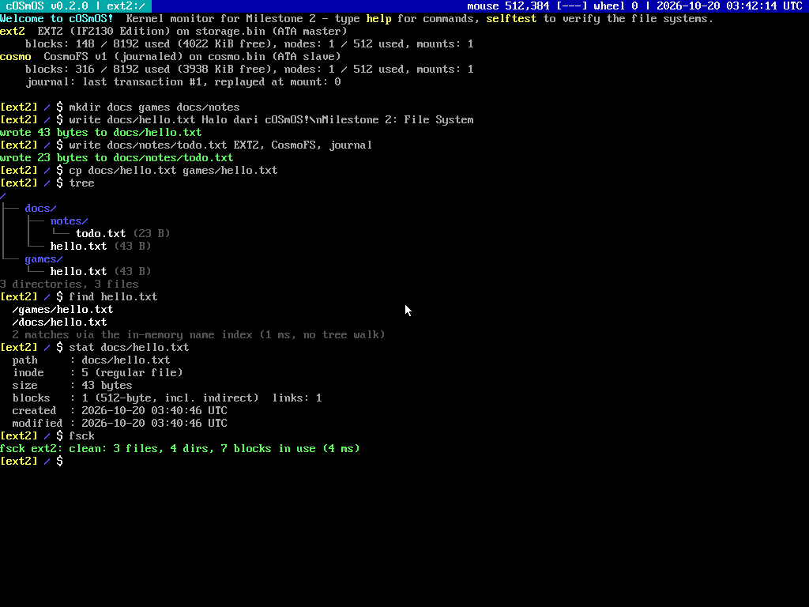
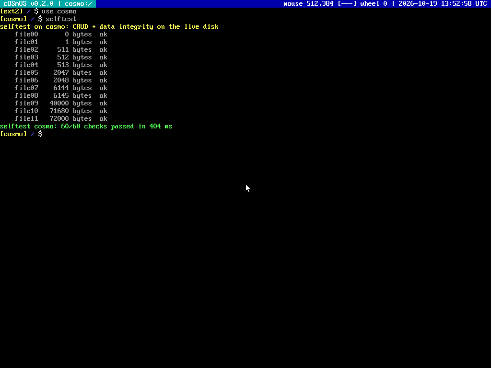

<p align="center">
  
</p>

<h1 align="center">cOSmOS</h1>

<p align="center">
  Sistem operasi x86 32-bit (protected mode) untuk Tugas Besar IF2130 Sistem Operasi 2026/2027.<br>
  Release saat ini: <b>v0.2.0 - Milestone 2 (File System)</b>
</p>


## Nama Kelompok

**cOSmOS**

| Anggota (GitHub) | Nama | NIM |
| --- | --- | --- |
| [@FahrezyyF](https://github.com/FahrezyyF) | _diisi_ | 13525072 |
| [@TheProfessorDuck](https://github.com/TheProfessorDuck) | Christian Immanuel | 13525116 |
| [@ZelosoleZW](https://github.com/ZelosoleZW) | Denzel Santoso | 13525014 |
| [@i-jer](https://github.com/i-jer) | Jeremy Gerald Sutanto | 13525104 |

## Daftar Isi

- [Nama Kelompok](#nama-kelompok)
- [Cara Run](#cara-run)
  - [Prasyarat](#prasyarat)
  - [Build dan menjalankan OS](#build-dan-menjalankan-os)
  - [Disk image](#disk-image)
  - [Inserter (host)](#inserter-host)
  - [Testing](#testing)
- [Fitur yang Dibuat](#fitur-yang-dibuat)
  - [Milestone 0: Toolchain, Kernel, GDT](#milestone-0-toolchain-kernel-gdt)
  - [Milestone 1: Interrupt, Driver](#milestone-1-interrupt-driver)
  - [Milestone 2: File System](#milestone-2-file-system)
  - [Bonus](#bonus)
  - [Kernel monitor](#kernel-monitor)
- [Desain File System](#desain-file-system)
  - [EXT2 - IF2130 Edition](#ext2---if2130-edition)
  - [CosmoFS](#cosmofs)
- [Struktur Repository](#struktur-repository)
- [Catatan untuk Milestone 3](#catatan-untuk-milestone-3)
- [Maskot Kelompok](#maskot-kelompok)
- [Kredit dan Referensi](#kredit-dan-referensi)

## Cara Run

### Prasyarat

Linux / WSL2 (Ubuntu 22.04 atau 24.04) dengan toolchain dari Book 0.1.2:

```bash
sudo apt update
sudo apt install -y nasm gcc qemu-system-x86 qemu-utils make genisoimage gdb
```

Untuk VS Code, pasang ekstensi *C/C++ Extension Pack* (dan *WSL* bila memakai WSL).

### Build dan menjalankan OS

```bash
make run
```

`make run` mem-build kernel, membuat `bin/OS2025.iso`, membuat disk image bila belum ada, lalu menjalankan QEMU. OS langsung boot (tanpa menunggu debugger).

| Perintah | Kegunaan |
| --- | --- |
| `make build` | Kompilasi kernel dan buat `bin/OS2025.iso` |
| `make run` | Build lalu jalankan QEMU (dua disk terpasang) |
| `make debug` | Sama seperti `run`, tetapi QEMU menunggu gdb di `localhost:1234` |
| `make run-sound` | Seperti `run`, PC speaker diarahkan ke PulseAudio (WSLg / Linux desktop) |
| `make disk` | **Menghapus** dan membuat ulang `bin/storage.bin` dan `bin/cosmo.bin` (4 MiB) |
| `make inserter` | Build program host `bin/inserter` (Book 3.3.1) |
| `make test` | Build dan jalankan semua unit test host (AddressSanitizer + UBSan) |
| `make clean` | Hapus hasil build (disk image tidak ikut terhapus) |

Debugging dengan VS Code: tekan **F5** (konfigurasi *Kernel*). Task `Launch QEMU` sudah memasang kedua disk image dan membuatnya bila belum ada.

Mode tampilan: secara default kernel memakai mode grafis 1024x768. Untuk memaksa VGA text mode 80x25:

```bash
make clean && make run DISPLAY_MODE=text
```

Di dalam QEMU, klik jendela QEMU untuk mengaktifkan mouse, lalu `Ctrl+Alt+G` untuk melepasnya.

### Disk image

| Disk | Posisi ATA | File system | Keterangan |
| --- | --- | --- | --- |
| `bin/storage.bin` | primary master | EXT2 - IF2130 Edition | File system utama (spesifikasi wajib) |
| `bin/cosmo.bin` | primary slave | CosmoFS | File system buatan sendiri (bonus) |

Disk kosong diformat otomatis saat boot. Data bersifat persisten: `make run` tidak pernah menghapus disk, hanya `make disk` yang melakukannya.

### Inserter (host)

Program host untuk memasukkan file atau folder dari Linux ke `storage.bin`. Program ini memakai `ext2.c` yang sama persis dengan kernel.

```bash
make inserter
./bin/inserter README.md 1 bin/storage.bin
./bin/inserter -r src/header 1 bin/storage.bin
./bin/inserter -l 1 bin/storage.bin
```

Argumen: `[-f] [-r] <file atau folder> <inode parent> <storage>`. Inode root adalah `1`. `-f` mengganti entry yang sudah ada, `-r` memasukkan folder secara rekursif, `-l <inode>` menampilkan isi direktori. Setelah menulis, inserter memverifikasi ulang isi file dan menjalankan `ext2_check`.

### Testing

```bash
make test
```

Kode file system tidak bergantung pada hardware (hanya `read_blocks` / `write_blocks`), jadi diuji di host dengan RAM disk:

| Suite | Cek | Isi |
| --- | --- | --- |
| `test-ext2` | 12.226 | Layout format, round trip ukuran 0 B sampai 1 MiB (direct, single, double indirect), byte di batas block, semua error code tabel Book 2.6, first fit, disk penuh dan inode habis (atomik), direktori lebih dari 12 block, rename, indexing, kompatibilitas `sample-image.bin`, 4.000 operasi acak dibandingkan model + `ext2_check` |
| `test-cosmofs` | 6.704 | CRUD, urutan direktori, extent dan overflow block, index dan rebuild tombstone, **simulasi mati listrik di setiap block write** untuk 6 operasi, 3.000 operasi acak, deteksi CRC |
| `test-string` | 463 | `string.c` kernel dibandingkan dengan glibc |
| `test-format` | 150 | `vsnprintf` kernel dibandingkan dengan glibc |

Di dalam OS, perintah `selftest` pada kernel monitor menjalankan uji CRUD dan integritas data langsung di disk ATA (60 cek per file system).

## Fitur yang Dibuat



### Milestone 0: Toolchain, Kernel, GDT

- Kernel C dengan entrypoint multiboot dari GRUB legacy, linker script di 1 MiB.
- Makefile otomatis: semua `.c` / `.s` di `src/` dikompilasi tanpa perlu menambah baris manual, dengan dependency header (`-MMD`).
- Global Descriptor Table: null descriptor, kernel code, kernel data, lalu `load_gdt` masuk ke protected mode.

### Milestone 1: Interrupt, Driver

- Text framebuffer `framebuffer_write`, `framebuffer_set_cursor`, `framebuffer_clear` (VGA 80x25).
- PIC remapping (IRQ ke `0x20`-`0x2F`), IDT 64 gate, ISR stub assembly, `main_interrupt_handler`.
- Keyboard driver scancode set 1: ring buffer 64 key, Shift, Caps Lock, Ctrl (`Ctrl+C` = `0x03`), Alt, extended key (panah, Home, End, Delete, Page Up/Down, keypad Enter).
- Exception CPU (selain debug, breakpoint, overflow) menampilkan layar panic berisi nama exception, error code, register, dan CR2 untuk page fault.


### Milestone 2: File System

- **ATA PIO disk driver**: `read_blocks` / `write_blocks` sesuai Book 2.1, ditambah pemilihan master/slave, `IDENTIFY` untuk deteksi disk, `FLUSH CACHE`, dan timeout di setiap polling. Disk yang tidak terpasang tidak membuat kernel hang.
- **EXT2 - IF2130 Edition** (`src/filesystem/ext2.c`):
  - `create_ext2`, `is_empty_storage`, `initialize_filesystem_ext2`.
  - CRUD `read`, `read_directory`, `write`, `delete` dengan error code persis seperti tabel Book 2.6.
  - Alokasi first fit, direct + single + double + triple indirect block.
  - Directory entry ala ext2 (`rec_len` split dan merge).
  - Semua sumber daya diperiksa sebelum menulis, sehingga request yang gagal tidak mengubah disk sama sekali.
- Ekstensi EXT2: `ext2_rename` (mv file dan folder, `..` ikut diperbarui), `ext2_lookup`, `ext2_find` (indexing), `ext2_check` (fsck), timestamp dari RTC.
- `KERNEL_STACK_SIZE` dinaikkan menjadi 2 MiB (Book 2.6).
- Program host **Inserter** (dari kit Chapter 3) sudah siap dipakai.

### Bonus

| Bonus (dokumen IF2130 Bonus 2026) | Poin | Status | Implementasi |
| --- | --- | --- | --- |
| Konfigurasi display output dan graphics driver | 3 | Selesai | Bochs/QEMU VBE (BGA) 1024x768x32, alamat framebuffer dari PCI BAR0, font 8x16 CP437, grid 128x48, kursor underline berkedip. Fallback otomatis ke text mode. |
| File system non-EXT2 dan non-FAT32 | 8 | Selesai | **CosmoFS** di `cosmo.bin`: extent, node tree terurut, CRC32, journaling write-ahead. |
| File System Indexing | 2 | Selesai | CosmoFS: hash index on-disk (open addressing, rebuild tombstone otomatis). EXT2: name index di memori yang dibangun saat mount. |
| Hardware Drivers: Speaker | 1 | Selesai | PIT channel 2, chime saat boot, perintah `beep` (`make run-sound`). |
| Hardware Drivers: Mouse | 3 | Selesai | PS/2 IRQ12, deteksi scroll wheel IntelliMouse, pointer di layar dan status bar. |
| Kreativitas | s.d. 5 | Selesai | Splash screen, layar panic, shutdown dan reboot, kernel monitor, jam CMOS, log serial COM1. |
| Aku anak rajin! | - | - | Release tag `v0.2.0` sebelum deadline 20 Oktober 2026 21.30 WIB. |

### Kernel monitor

Shell user mode baru dikerjakan pada Milestone 3. Untuk mendemokan Milestone 2, kernel menyediakan *monitor* interaktif dengan status bar (volume aktif, path, posisi mouse, jam), history `Up`/`Down`, `Ctrl+C`, dan `Ctrl+L`. Path relatif dan absolut (`a/b`, `..`, `/`) didukung.

| Perintah | Fungsi |
| --- | --- |
| `ls [-l] [dir]`, `cd`, `pwd`, `tree [dir]` | Navigasi direktori |
| `mkdir`, `touch`, `write <file> <teks>`, `cat`, `cp`, `mv`, `rm` | CRUD file dan folder |
| `find <nama>` | Pencarian lewat index (tanpa DFS) |
| `stat <path>`, `hexdump <file>` | Metadata inode/node dan isi mentah |
| `use ext2\|cosmo`, `df`, `fsck`, `selftest` | Pilih volume, kapasitas, cek konsistensi, uji integritas |
| `time`, `beep`, `mouse`, `sysinfo` | Driver RTC, speaker, mouse, ringkasan hardware |
| `crash`, `reboot`, `shutdown` | Demo layar panic, restart, dan power off ACPI |



## Desain File System

### EXT2 - IF2130 Edition

Disk 4 MiB = 8.192 block x 512 byte, dibagi 8 block group x 1.024 block, 512 inode (128 byte, 64 per group). Root adalah inode 1.

| Lokasi | Isi |
| --- | --- |
| Block 0 | Boot sector berisi `fs_signature` cOSmOS |
| Block 1 | Superblock |
| Block 2 | Block group descriptor table |
| Group 0 mulai block 3, group g mulai block g x 1024 | +0 block bitmap, +1 inode bitmap, +2..+17 inode table, sisanya data block |

Layout, inode 128 byte, header directory entry 8 byte, dan urutan bit bitmap (MSB-first) sama byte-per-byte dengan `.kit/ch2/sample-image.bin`. Driver bisa membaca dan menulis image contoh tersebut setelah boot sector-nya diganti dengan `fs_signature` kita (diuji di `test-ext2`).

Perbaikan terhadap kit `ext2.h`:

1. `GROUPS_COUNT` tidak diberi kurung. Akibatnya `BLOCKS_PER_GROUP` bernilai 256, padahal seharusnya 1.024.
2. `name_len` pada `EXT2DirectoryEntry` dideklarasikan `uint16_t`, padahal di disk 8-bit. Header kit jadi 9 byte, tidak sesuai ext2 maupun sample image.
3. `EXT2Inode` kit hanya 70 byte. Struct kini 128 byte, sesuai sample image (dengan timestamp).
4. `#include "../stdlib/stdtype.h"` menunjuk file yang tidak ada.
5. `EXT2BlockGroupDescriptorTable` hanya 256 byte. Membaca satu block 512 byte langsung ke struct itu akan menimpa memori, jadi dibaca lewat `BlockBuffer`.

### CosmoFS

```
| boot | superblock | journal | bitmap | node table      | name index | data (extent) |
| 0    | 1 (CRC32)  | 40 blk  | 2 blk  | 512 node x 256B | 1024 slot  | 316 .. 8191   |
```

- **Node** 256 byte: nama (s.d. 127 byte), ukuran, flag *is_present*, parent, timestamp, 8 extent inline, CRC32.
- **Direktori** tidak punya data block. Anak-anaknya membentuk doubly linked list yang selalu terurut nama, jadi `ls` otomatis terurut.
- **File** disimpan sebagai extent `(start, length)`. Alokasi memakai best fit, lalu run terbesar bila tidak muat. Extent lebih dari 8 disimpan di rantai overflow block.
- **Name index**: hash table on-disk FNV-1a, dipakai untuk lookup `(parent, nama)` dan `find`.
- **Journal**: setiap operasi adalah satu transaksi. Metadata ditulis ke journal (descriptor, payload, commit record ber-CRC), lalu di-*checkpoint*; superblock ditulis paling akhir. Data baru ditulis sebelum commit (*ordered mode*). Saat mount, transaksi yang sudah commit tetapi belum selesai di-*checkpoint* akan di-*replay*.
- Hasil uji mati listrik: untuk setiap titik crash, volume selalu kembali ke keadaan *sebelum* atau *sesudah* operasi dan `cosmofs_check` bersih.

## Struktur Repository

```
src/
├── kernel-entrypoint.s, kernel.c, linker.ld, menu.lst
├── cpu/          gdt, idt, interrupt (PIC, dispatcher), intsetup.s, portio
├── driver/       keyboard, disk (ATA), timer (PIT), mouse, speaker, rtc, serial, pci, power
├── text/         framebuffer (text + grafis), console, font8x16
├── graphics/     BGA graphics driver
├── filesystem/   ext2.c, cosmofs.c, vfs.c
├── kernel/       monitor, splash, panic
├── stdlib/       string.c, format.c (vsnprintf)
├── external/     external-inserter.c (program host)
└── header/       header untuk semua modul di atas
test/             unit test host (make test)
tools/gen_font.py generator font8x16.c dari font console PSF
docs/             screenshot dan maskot
```

## Catatan untuk Milestone 3

- Saat paging higher half aktif, linear framebuffer (alamat dari PCI BAR0, di QEMU `0xFD000000`) harus di-*map* di page table. Bila tidak, gunakan `make run DISPLAY_MODE=text`.
- Image kernel + `.bss` sekitar 2,7 MiB (2 MiB di antaranya stack). Masih muat di mapping 4 MiB pertama dari kit Chapter 3.
- Kernel monitor hanya alat demo Milestone 2. Shell Chapter 3 tetap berjalan di user mode dan memanggil `read`, `read_directory`, `write`, `delete` lewat syscall.
- IRQ0 (PIT 1.000 Hz) sudah aktif dan di-ACK di `timer_isr`, siap dipakai scheduler Chapter 4.

## Maskot Kelompok

<p align="center"></p>

**Cosmo**, planet kecil bercincin yang menjadi logo boot splash cOSmOS.

## Kredit dan Referensi

- IF2130 Book (Edisi 4), Hub, dan dokumen Bonus 2026 oleh Asisten Lab Sister ITB. Template repository: [os-template-2026](https://github.com/Nathan-Marpaung/os-template-2026).
- Glyph font 8x16: `u_vga16.bdf`, Copyright (c) 2000, 2001 Dmitry Bolkhovityanov (lisensi MIT-style), diambil dari paket console-setup (`tools/gen_font.py`).
- [OSDev Wiki](https://wiki.osdev.org/): ATA PIO, Bochs VBE Extensions, PS/2 Mouse, PIT, CMOS, Ext2.
- [The Second Extended File System](https://www.nongnu.org/ext2-doc/ext2.html) oleh Dave Poirier.
- Dikerjakan dengan bantuan Claude Code (Anthropic); proses dan analisisnya dicatat di jurnal kelompok.
