<p align="center">
  
</p>

<h1 align="center">cOSmOS</h1>

<p align="center">
  Sistem operasi x86 32-bit (protected mode) untuk Tugas Besar IF2130 Sistem Operasi 2026/2027.<br>
  Release: <b>v1.0.0 - Milestone 4 (Process, Scheduler, Multitasking), final release</b>
</p>

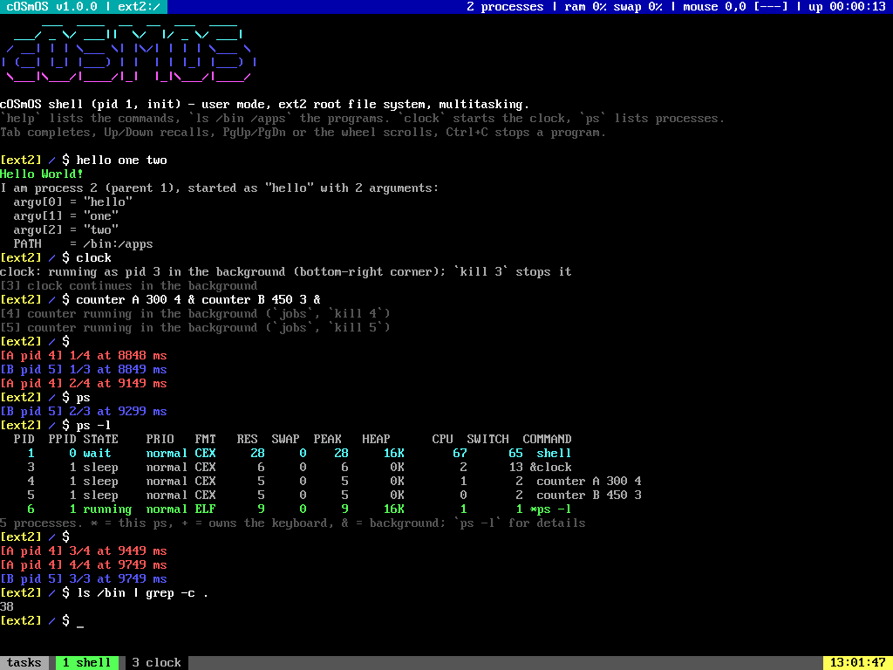

## Nama Kelompok

**cOSmOS** - kontributor sistem operasi:

| Anggota (GitHub) | Nama | NIM |
| --- | --- | --- |
| [@FahrezyyF](https://github.com/FahrezyyF) | Fahrezy Fitriansyah | 13525072 |
| [@TheProfessorDuck](https://github.com/TheProfessorDuck) | Christian Immanuel | 13525116 |
| [@ZelosoleZW](https://github.com/ZelosoleZW) | Denzel Santoso | 13525014 |
| [@i-jer](https://github.com/i-jer) | Jeremy Gerald Sutanto | 13525104 |

## Daftar Isi

- [Nama Kelompok](#nama-kelompok)
- [Cara Run](#cara-run)
  - [Prasyarat](#prasyarat)
  - [Build dan menjalankan OS](#build-dan-menjalankan-os)
  - [Memilih root file system](#memilih-root-file-system)
  - [Menguji paging dan swap dengan RAM kecil](#menguji-paging-dan-swap-dengan-ram-kecil)
  - [Jaringan](#jaringan)
  - [Video (Bad Apple!!)](#video-bad-apple)
  - [Disk image dan program host](#disk-image-dan-program-host)
  - [Testing](#testing)
- [Fitur yang Dibuat](#fitur-yang-dibuat)
  - [Milestone 0 sampai 3](#milestone-0-sampai-3)
  - [Milestone 4: Process](#milestone-4-process)
  - [Milestone 4: Scheduler dan Context Switch](#milestone-4-scheduler-dan-context-switch)
  - [Milestone 4: Multitasking](#milestone-4-multitasking)
  - [System call](#system-call)
  - [Shell](#shell)
  - [Aplikasi](#aplikasi)
  - [Bonus](#bonus)
- [Desain Memori](#desain-memori)
- [Format Executable CEX](#format-executable-cex)
- [Desain File System](#desain-file-system)
- [Struktur Repository](#struktur-repository)
- [Maskot Kelompok](#maskot-kelompok)
- [Kredit dan Referensi](#kredit-dan-referensi)

## Cara Run

### Prasyarat

Linux / WSL2 (Ubuntu 22.04 atau 24.04) dengan toolchain dari Book 0.1.2, ditambah Python 3 (untuk klip video demo):

```bash
sudo apt update
sudo apt install -y nasm gcc qemu-system-x86 qemu-utils make genisoimage gdb python3
```

Opsional: `ffmpeg` untuk mengonversi video sendiri (bonus Bad Apple!!). Untuk VS Code, pasang *C/C++ Extension Pack* (dan *WSL* bila memakai WSL).

### Build dan menjalankan OS

```bash
make run
```

`make run` melakukan semuanya: build kernel dan ISO, build shell dan semua program user (`/bin`, `/apps`, `/games`, klip `/media/demo.cvid`), build program host, membuat disk image bila belum ada, memasukkan semua program dan file contoh (`rootfs/`) ke **kedua** disk, lalu menjalankan QEMU dengan kartu jaringan RTL8139. GRUB menampilkan menu selama 3 detik, kemudian boot ke EXT2.

| Perintah | Kegunaan |
| --- | --- |
| `make build` | Kompilasi kernel dan buat `bin/OS2025.iso` |
| `make run` | Build, `insert-shell`, lalu jalankan QEMU |
| `make debug` | Sama seperti `run`, tetapi QEMU menunggu gdb di `localhost:1234` |
| `make run-sound` | Seperti `run`, PC speaker diarahkan ke PulseAudio (WSLg / Linux desktop) |
| `make user-shell` | Build shell: `bin/shell_elf` (ELF dengan simbol untuk gdb) dan `bin/shell` (CEX) |
| `make user-programs` | Build semua program user ke `bin/rootfs/{bin,apps,games,media}` |
| `make insert-shell` | Masukkan shell dan semua program (`-f`, versi lama diganti) serta isi `rootfs/` (`-k`) ke `storage.bin` dan `cosmo.bin` |
| `make video VIDEO=file.mp4` | Konversi video ke `/media/badapple.cvid` (perlu `ffmpeg`) |
| `make disk` | **Menghapus** dan membuat ulang kedua disk image (12 MiB) |
| `make test` | Build dan jalankan semua unit test host (AddressSanitizer + UBSan) |
| `make clean` | Hapus hasil build (disk image tidak ikut terhapus) |

Debugging dengan VS Code: tekan **F5** (konfigurasi *Kernel*). gdb memuat simbol `kernel` dan `shell_elf`, jadi breakpoint bisa dipasang di kode kernel maupun shell. Di dalam QEMU, klik jendela QEMU untuk mengaktifkan mouse, lalu `Ctrl+Alt+G` untuk melepasnya.

Setelah boot, coba (lihat juga `/README.txt` dan `sh /scripts/m4demo.sh`):

```
hello a b c                       program terpisah dengan argc/argv
clock                             jam di pojok kanan bawah, berjalan di background
counter A 300 5 & counter B 500 5 &
ps -l ; top ; sched               proses, CPU, scheduler
ls /bin | grep -c .               pipeline dua program terpisah
export PATH=$PATH:/games ; snake  PATH (persistent), game yang mem-blok shell
gclock ; bounce ; paint           window compositor (mode grafis)
ping 10.0.2.2 ; nslookup example.com
vplay /media/demo.cvid            video player
```

### Memilih root file system

cOSmOS punya dua file system, tetapi **hanya satu yang di-mount sebagai root** (sesuai masukan asisten setelah Milestone 2). Pilihannya ada di menu GRUB dan diteruskan ke kernel sebagai parameter `fs=`:

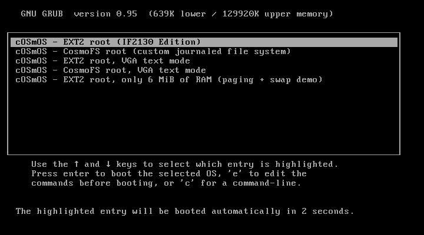

| Entry GRUB | Parameter kernel | Root file system |
| --- | --- | --- |
| cOSmOS - EXT2 root (default) | `fs=ext2` | EXT2 - IF2130 Edition di `storage.bin` (spesifikasi wajib) |
| cOSmOS - CosmoFS root | `fs=cosmo` | CosmoFS di `cosmo.bin` (bonus file system sendiri) |
| ... VGA text mode | `video=text` | Sama, tetapi tampilan 80x25 (tanpa window compositor) |
| ... only 6 MiB of RAM | `mem=6` | Kernel hanya mengelola 6 MiB RAM (demo swap) |

Disk lain **tidak disentuh sama sekali**: shell, semua program, syscall, dan swap selalu memakai disk root.

```bash
make run FS=cosmo          # boot langsung ke CosmoFS
make run GRUB_TIMEOUT=0    # lewati menu GRUB
make run DISPLAY_MODE=text # paksa VGA text mode saat build
```

### Menguji paging dan swap dengan RAM kecil

Ukuran RAM yang dikelola kernel = minimum dari `SYSTEM_MEMORY_MB` (di `paging.h`), RAM dari GRUB, dan parameter `mem=`.

```bash
make run SYSTEM_MEMORY_MB=5   # ubah konstanta saat compile (cara penguji); minimum 5 MiB
make run QEMU_MEMORY=8M       # RAM fisik QEMU (-m)
make run                      # lalu pilih entry "only 6 MiB of RAM"
```

Dengan banyak proses sekaligus, misalnya `memtest 3 & memtest 3 & memtest 4` pada RAM 6 MiB (2 MiB untuk page user), clock replacement memindahkan page dari ketiga address space ke swap dan semua data tetap terverifikasi:

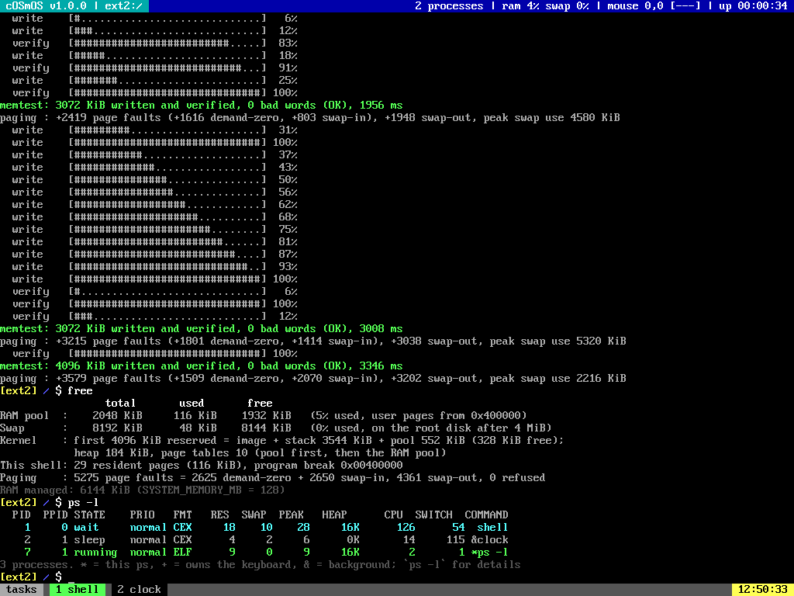

### Jaringan

`make run` memasang kartu RTL8139 di jaringan user-mode QEMU: cOSmOS memakai `10.0.2.15/24`, gateway (host) `10.0.2.2`, DNS `10.0.2.3`, dan port UDP host 5555 diteruskan ke port 5555 guest.

```bash
# di cOSmOS
ifconfig ; ping 10.0.2.2 ; nslookup example.com
udpecho &                              # server echo UDP di port 5555
udpsend 10.0.2.2 6000 halo dari cOSmOS # datagram ke host
# di host (terminal lain)
nc -u localhost 5555                   # ketik teks, dibalas huruf besar oleh udpecho
nc -ul 6000                            # menerima datagram dari udpsend
```

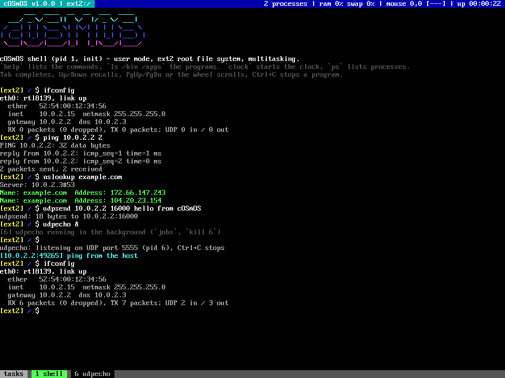

### Video (Bad Apple!!)

`vplay` memutar video 1-bit format CVID dari file system, di window (mode grafis, default skala x3) atau sebagai ASCII di konsol (`vplay -t`, atau otomatis di text mode). Klip demo `/media/demo.cvid` dibuat saat build. Untuk Bad Apple!!, sediakan file videonya sendiri:

```bash
make video VIDEO=~/bad_apple.mp4      # -> /media/badapple.cvid (160x120, 30 fps)
make run
# di cOSmOS:  vplay /media/badapple.cvid   (tutup window, Q, atau Ctrl+C untuk berhenti)
```

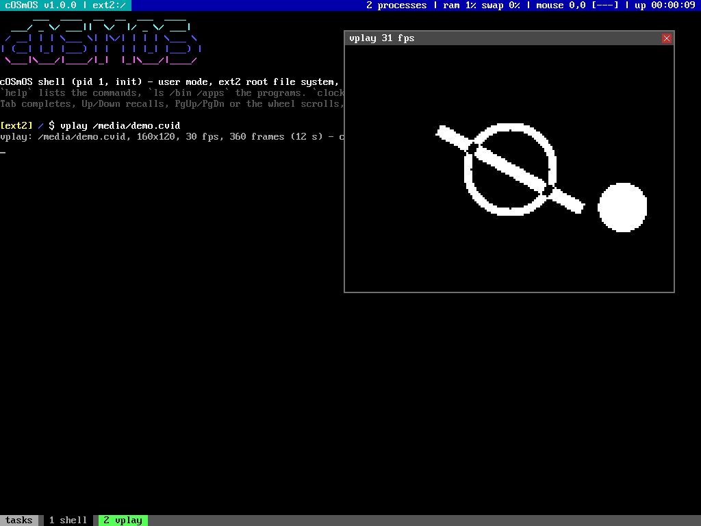

### Disk image dan program host

| Disk | Posisi ATA | Isi |
| --- | --- | --- |
| `bin/storage.bin` | primary master | 4 MiB EXT2 + 8 MiB swap |
| `bin/cosmo.bin` | primary slave | 4 MiB CosmoFS + 8 MiB swap |

- Disk 12 MiB: region file system 4 MiB, lalu partisi swap 8 MiB (2.048 slot x 4 KiB). Disk kosong diformat otomatis; `make run` tidak pernah menghapus data, hanya `make disk` yang melakukannya.
- `inserter` (EXT2) dan `cosmofs-tool` (CosmoFS) memakai driver file system yang sama persis dengan kernel. Opsi: `-f` ganti, `-k` biarkan yang ada, `-r` rekursif, `-l <inode>` daftar isi. Root kedua file system adalah inode 1.
- `elf2cex` (`src/external/elf2cex.c`) mengubah ELF hasil linker menjadi executable CEX.
- `tools/video2cvid.py` mengubah video menjadi CVID.

```bash
./bin/inserter shell 1 bin/storage.bin          # Book 3.3.1 (root EXT2 IF2130 = inode 1)
./bin/inserter -f -r bin/rootfs/bin 1 bin/storage.bin
./bin/elf2cex bin/shell_elf bin/shell shell
```

### Testing

```bash
make test
```

| Suite | Cek | Isi |
| --- | --- | --- |
| `test-heap` | 66.610 | Allocator `heap.c` (kmalloc dan malloc): 40.000 operasi acak, coalescing, realloc in place, double free, trim |
| `test-regex` | 59.003 | Regex `grep`, termasuk differential test terhadap `regcomp`/`regexec` glibc |
| `test-ext2` | 12.226 | CRUD Book 2.6, round trip 0 B s.d. 1 MiB, kompatibilitas `sample-image.bin`, 4.000 operasi acak vs model |
| `test-cosmofs` | 6.704 | CRUD, extent, index, simulasi mati listrik di setiap block write, CRC |
| `test-pipe` | 52 | Pipe kernel: urutan FIFO, ring yang membesar sampai 1 MiB, EOF, broken pipe, batas pool |
| `test-cex` | 19 | `bin/shell` hasil `elf2cex` lolos validator loader kernel; 10 jenis kerusakan (checksum, alignment < 2 KiB, `.text` writable, entry di luar `.text`, overlap, ...) ditolak; CRC-32 known answer |
| `test-string`, `test-format` | 613 | `string.c` dan `vsnprintf` kernel dibandingkan dengan glibc |

Pengujian di QEMU (headless, input lewat monitor QEMU, output lewat screenshot dan log serial): boot EXT2 grafis dan CosmoFS text mode, program flat/CEX/ELF, argumen, `ps`, clock + kill + jalankan ulang, job background, pipeline program dan built-in, redirection, Ctrl+C, `exit` init (shell baru), crash `null`/`ro` (hanya proses itu yang mati), 16 proses sekaligus, PATH bertahan setelah reboot, RAM 6 MiB dengan tiga `memtest` + swap, window compositor (tiga window, drag, fokus, menggambar), jaringan (ping, DNS, UDP dua arah), dan video 30 fps.

## Fitur yang Dibuat

### Milestone 0 sampai 3

- **M0**: kernel multiboot (GRUB legacy), Makefile otomatis (`-MMD`), GDT, protected mode.
- **M1**: framebuffer VGA dan BGA 1024x768, PIC remap, IDT 64 gate, keyboard scancode set 1, layar panic.
- **M2**: driver ATA PIO, **EXT2 - IF2130 Edition** (CRUD Book 2.6, direct s.d. triple indirect, rename, index, fsck), **CosmoFS** (bonus), mouse, speaker, RTC (CMOS), splash screen.
- **M3**: higher half kernel, paging 4 KiB dua level dengan physmap, frame allocator, demand paging, **swap** (slot dicatat di PTE, page replacement clock lintas address space, commit limit), kernel heap, user mode (GDT user segment, TSS), system call `int 0x30`, shell user mode dengan pipeline, redirection, script, history, tab completion, scrollback.

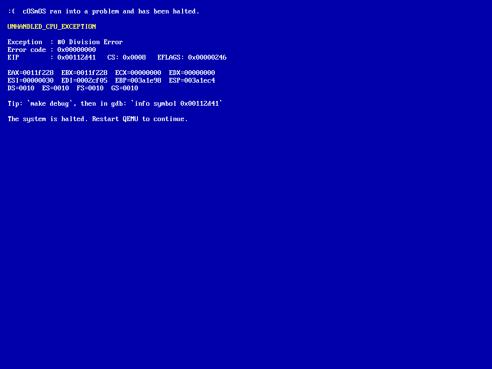

### Milestone 4: Process

Kode: `src/process/process.c`, `src/header/process/process.h`, `src/process/exec.c`, `src/memory/paging.c`.

- **Koreksi kit Chapter 1** (Book 4.1.0): `struct CPURegister` kini `ebp` sebelum `esp`; `intsetup.s` sudah sama dengan versi koreksi.
- **Multi virtual address space** (Book 4.1.1): `paging_create_new_page_directory`, `paging_free_page_directory`, `paging_get_current_page_directory_addr`, `paging_use_page_directory` di atas `page_directory_list[32]` statis di image kernel. Kit hanya menyalin satu PDE 4 MiB (`0x300`); cOSmOS memetakan kernel dengan page table 4 KiB (image, physmap, kernel heap, framebuffer), jadi **semua PDE kernel 768-1023 disalin** dan page table-nya dipakai bersama semua proses. PDE kernel yang ditambah setelah boot disinkronkan ke semua page directory.
- **Process Control Block** (Book 4.1.2): `struct Context` (semua register, `eip`, `eflags`, page directory; offset dipakai oleh assembly), `PROCESS_STATE` (`INACTIVE`, `READY`, `RUNNING`, `BLOCKED`) ditambah alasan menunggu (`sleep`, `key`, `wait`, `pipe`, `window`, `net`), metadata (PID, parent, nama, cmdline, prioritas, waktu CPU, jumlah switch, CWD), memori, dan tabel file descriptor. `_process_list[PROCESS_COUNT_MAX]` dengan 16 slot.
- **Process creation** (Book 4.1.3): `process_create_user_process(request)` mengikuti alur buku dengan kode `PROCESS_CREATE_*` (ditambah 5 executable rusak, 6 argumen tidak valid, 7 bukan executable): validasi, page directory baru, file executable dibaca ke buffer kernel, CR3 diganti sementara ke address space baru untuk menyalin isi program (page dialokasikan lewat page fault), stack awal berisi `argc`, `argv`, `envp`, context awal (segment user DPL 3, `eflags = BASE | IF`), metadata, lalu CR3 dikembalikan. Kegagalan di tengah jalan membebaskan semuanya (`goto exit_cleanup`).
- **Loader tiga format** (`exec.c`): **CEX** (format sendiri, lihat [Format Executable CEX](#format-executable-cex)), **ELF32** (Book 4.3.6), dan **flat binary** (Book Chapter 3, dimuat di `0x0`). Section `.text`/`.rodata` dipetakan **read-only**, `.data`/`.bss` writable, page 0 tidak dipetakan sehingga NULL pointer langsung page fault. `CR0.WP` dinyalakan agar kernel pun tidak bisa ditipu syscall menulis ke page read-only.
- **Process: Init** (Book 4.1.4): `kernel_setup()` menyusun GDT, IDT, PIC, file system, TSS, lalu membuat shell sebagai proses init (PID 1), `scheduler_init()`, `scheduler_switch_to_next_process()`. `kernel_execute_user_program(entry, user_stack)` disesuaikan dengan konvensi stack process creation.
- **Terminasi**: `process_terminate` membebaskan semua page lewat daftar page PCB, slot swap, page table, page directory, pipe, window, socket, dan widget; status exit diteruskan ke parent yang menunggu. **Tidak ada zombie** (slot PCB langsung kosong; status terakhir disimpan di ring kecil untuk `wait`) dan **tidak ada orphan** (anak diadopsi init). Init yang berakhir dijalankan ulang oleh kernel.

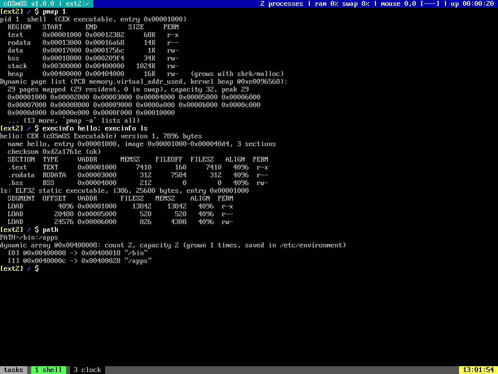

### Milestone 4: Scheduler dan Context Switch

Kode: `src/process/scheduler.c`, `src/process/context-switch.s`, `src/header/process/scheduler.h`, `src/driver/timer.c`.

- **IRQ0** (Book 4.2.1.1): `activate_timer_interrupt()` persis kode buku (PIT 1.000 Hz, square wave), PIC ACK setiap tick.
- **Algoritma: Round Robin** dengan time slice berdasarkan prioritas (`nice`): low 5 ms, normal 10 ms, high 20 ms. Preemptive: saat slice habis, context disimpan dan proses READY berikutnya dipilih secara melingkar.
- **Context switch** (Book 4.2.2): `process_context_switch(struct Context ctx)` di assembly menyimpan alamat `ctx`, menyusun stack `iret` (ss, esp, eflags, cs, eip), memuat segment dan semua register (base register terakhir), lalu `iret`. Page directory diganti di C (`paging_use_page_directory`) sebelumnya. `scheduler_save_context_to_current_running_pcb` dan `scheduler_switch_to_next_process` sesuai header kit.
- **Satu kernel stack, kernel tidak pernah di-preempt** (Book 4.1.3: tidak ada reentrancy). Context hanya disimpan saat interrupt datang dari ring 3; setiap switch adalah `iret` yang meninggalkan kernel stack, dan TSS `esp0` selalu menunjuk puncaknya.
- **Blocking system call yang bisa diulang**: `sleep`, `getchar`, `wait`, baca/tulis pipe, event window, dan UDP tidak berputar di kernel. Kernel menyimpan context *user* proses (untuk sebagian, `eip` dimundurkan 2 byte ke `int 0x30`), menandainya `BLOCKED`, dan menjalankan proses lain. Saat kondisinya terpenuhi proses menjadi `READY` dan syscall dijalankan lagi. Bila tidak ada proses siap, kernel idle dengan `hlt` di page directory kernel.
- Statistik: `sched` (context switch, preemption, blocking call, waktu idle/busy) dan `top` (CPU% per proses).

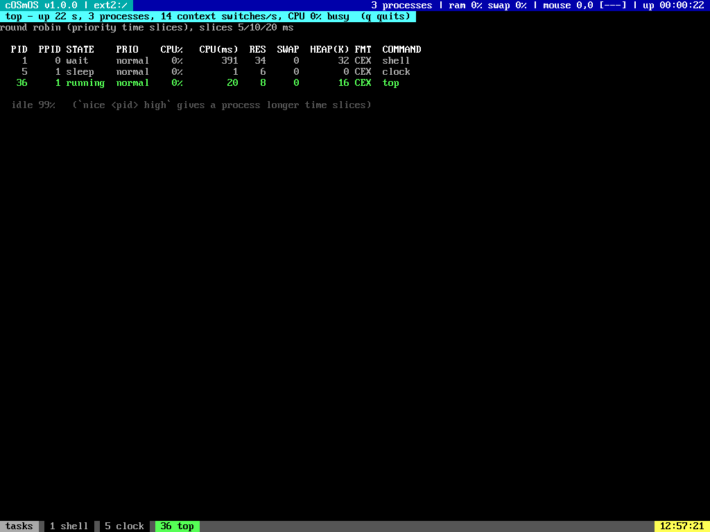

### Milestone 4: Multitasking

- **Entry point dan exit** (Book 4.3.1): `crt0.s` memanggil `main(argc, argv, envp)` lalu syscall terminate (`eax = 32`, sama dengan contoh `crt0-echo.s` buku; `26` juga bisa).
- **Process management** (Book 4.3.2): syscall pembuatan proses, kill berdasarkan PID, dan info proses, dipakai perintah `exec`, `ps`, `kill`, ditambah `jobs`, `wait`, `nice`, `pmap`, `sched`, `top`.
- **Clock** (Book 4.3.3): `/apps/clock` membaca CMOS RTC lewat `SYS_TIME` setiap 250 ms dan menampilkan `HH:MM:SS` di **pojok kanan bawah** (widget taskbar). Program ini melepaskan diri ke background (`SYS_DETACH`) sehingga prompt langsung kembali; `kill <pid>` menghentikannya (widget hilang) dan `clock` menjalankannya lagi. `export CLOCK_TZ=7` untuk WIB.
- **External application** (Book 4.3.4): `hello` ("Hello World!"), dan banyak aplikasi lain (lihat [Aplikasi](#aplikasi)), dijalankan dengan `exec <nama>` atau langsung dengan namanya.
- **Keyboard milik proses foreground**: hanya proses yang ditunggu shell yang menerima tombol; `Ctrl+C` mengakhiri proses foreground (bukan shell). Program background mencetak di baris baru, dan editor baris shell menggambar ulang prompt bila ada keluaran lain.
- **Taskbar** di baris terbawah: satu chip per proses (foreground hijau), widget program di kanan.

### System call

`int 0x30`, `eax` = nomor layanan, `ebx`/`ecx`/`edx` = argumen; setiap pointer dari user divalidasi terhadap region memori proses. Layanan 0-7 persis tabel Book 3.4.1.1.

| eax | Layanan | eax | Layanan |
| --- | --- | --- | --- |
| 0-3 | `read`, `read_directory`, `write`, `delete` | 32 | **terminate** (crt0) |
| 4-8 | `getchar`, `putchar`, `puts`, keyboard on, getchar blocking | 33 | **buat proses** (`SyscallExec`: path, argv, envp, stdin/stdout, foreground) |
| 9-13 | clear, cursor, ukuran layar, scroll konsol | 34 | **kill PID** |
| 14-18 | rename, stat, find, nama dari inode, info FS | 35 | **info proses** (`SyscallProcessInfo[]`) |
| 19-20 | `sbrk`, info memori | 36-40 | `wait`, `yield`, `getpid`, prioritas, detach |
| 21-25 | waktu RTC, uptime, `sleep` (blocking), beep, power | 41-45 | pipe, baca/tulis/tutup/info file descriptor |
| 26 | exit | 46-50 | `chdir`, `getcwd`, info scheduler, widget taskbar, peta memori proses |
| 27-31 | mouse, info sistem, status bar, fsck, info kernel heap | 51-56 | window compositor; 60-65 jaringan (UDP, ping) |

### Shell

Shell (`src/user/shell.c`) adalah proses init. Perintah yang butuh state shell adalah **built-in** (`cd`, `export`, `path`, `exec`, `jobs`, `wait`, `type`, `sh`, `set`, `history`, `help`, `exit`, ...); semua perintah lain adalah **program terpisah** di `/bin` (Book 4.3.6) yang ditemukan lewat `PATH`.

| Perintah | Keterangan |
| --- | --- |
| `exec [-b] <program> [args]` | Jalankan program dari file system (relatif, absolut, atau nama di PATH); `-b` atau `&` = background |
| `ps [-l]`, `kill <pid>`, `jobs`, `wait [pid]`, `nice <pid> <low\|normal\|high>` | Manajemen proses |
| `pmap [-a] [pid]`, `sched`, `execinfo <program>` | Peta memori dan daftar page proses, statistik scheduler, header CEX/ELF |
| `export NAME=value`, `path [add\|remove <dir>]`, `env`, `type <nama>` | Environment dan PATH |
| `cd`, `ls`, `pwd`, `mkdir`, `touch`, `cat`, `cp -r`, `rm -r`, `mv`, `find`, `grep` (regex), `tree`, `stat` | File system (Book 3.3.2.2) |
| `echo`, `write`, `head`, `tail`, `wc`, `sort`, `hexdump`, `free`, `heap`, `memtest`, `df`, `fsck`, `date`, `uptime`, `sleep`, `beep`, `sysinfo`, `crash` | Utilitas |

- **Sintaks**: pipeline `a | b`, redirection `>`, `>>`, `<`, urutan `;`, `&&`, `||`, background `&`, kutip, variabel `$NAME`, `$?`, `$$`, `$#`, glob, komentar.
- **Pipeline antarprogram**: input tahap sebelumnya dikirim lewat **pipe kernel** ke stdin program, dan stdout program dibaca shell lewat pipe lain bila masih ada tahap berikutnya atau redirection. Built-in dan program bisa dicampur (`ls /bin | head -n 3 | wc -l`).
- Program tanpa header CEX/ELF tidak dijalankan sebagai kode (kecuali script `.sh` / `#!`); `exec` tetap bisa menjalankan flat binary (`exec hello-flat`).
- Bonus M3 tetap ada: history (`Up`/`Down`, `!!`), **tab completion** (kini juga nama program di semua direktori PATH), scrollback (`PgUp`/`PgDn`, wheel), script `.sh`.

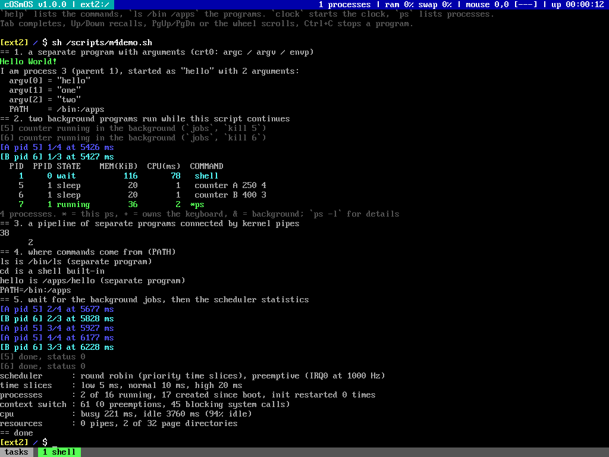

### Aplikasi

| Program | Format | Keterangan |
| --- | --- | --- |
| `/apps/hello` | CEX | "Hello World!", menampilkan PID, `argv`, dan `PATH` (Book 4.3.4) |
| `/apps/hello-flat` | flat | Program yang sama sebagai flat binary di `0x0` (format ketiga loader) |
| `/apps/clock` | CEX | Jam background di pojok kanan bawah (Book 4.3.3) |
| `/apps/counter` | CEX | Demo multitasking: penghitung periodik; `counter spin` memakai CPU terus (demo preemption) |
| `/apps/top` | CEX | Monitor proses langsung: CPU%, state, memori |
| `/games/snake` | CEX | Game di konsol yang **mem-blok shell** selama berjalan (bonus aplikasi lain); di luar PATH awal |
| `/apps/gclock`, `bounce`, `paint` | CEX | Aplikasi window: jam analog, animasi bola 30 fps, menggambar dengan mouse |
| `/apps/ifconfig`, `ping`, `nslookup`, `udpsend`, `udpecho` | CEX | Jaringan: info kartu, ICMP echo, query DNS lewat UDP, kirim/terima UDP |
| `/apps/vplay` | CEX | Video player CVID (window atau ASCII) |
| `/bin/*` (39 program) | ELF | Perintah shell terpisah (Book 4.3.6) |

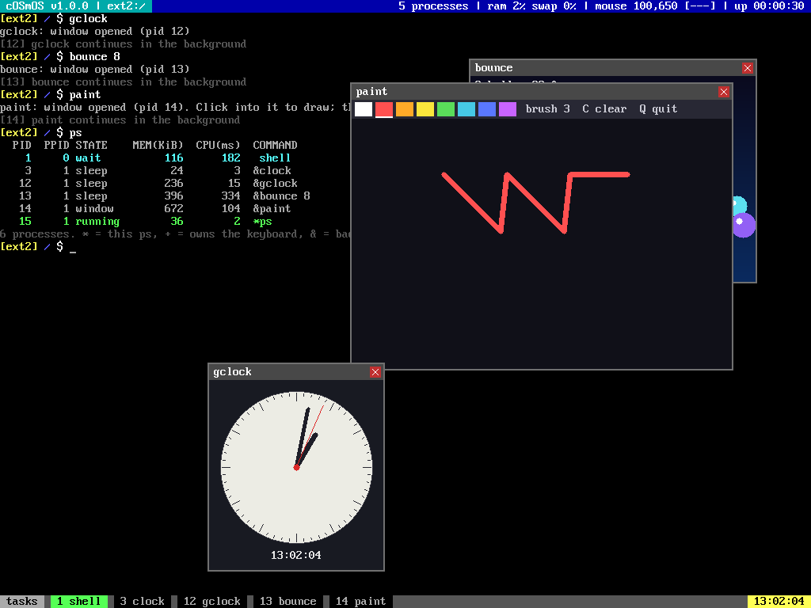

### Bonus

| Bonus (dokumen IF2130 Bonus 2026 dan Book) | Poin | Implementasi |
| --- | --- | --- |
| Display output dan graphics driver (M1) | 3 | BGA 1024x768x32, font 8x16, grid 128x48, kursor berkedip |
| File system non-EXT2 dan non-FAT32 (M2) | 8 | **CosmoFS**: extent, node tree terurut, CRC32, journaling; dipilih di menu GRUB |
| File System Indexing (M2) | 2 | Hash index on-disk (CosmoFS), name index (EXT2); dipakai `find` |
| HEAP Memory (M3) | s.d. 5 | Allocator `heap.c` (segregated free list, coalescing, realloc in place, trim) untuk `kmalloc` dan `malloc` (`sbrk`) |
| Recent commands, Scrollable shell, Tab autocomplete, Shell script (M3) | 1 + 1 + 3 + 2 | History 500, scrollback 2.000 baris, completion perintah/program/file, script `.sh` |
| **PATH array dinamis** (M4) | 1 | PATH disimpan sebagai array `char*` di heap yang menggandakan kapasitas dengan `realloc`; `path` menampilkan dump array (alamat, count, capacity, isi); `path add/remove`, `export` |
| **Environment variables / PATH persistent** (Book 4.3.5) | - | `export` menyimpan variabel ke `/etc/environment` (dimuat saat shell mulai, juga setelah reboot); `envp` diteruskan ke setiap program (`getenv`) |
| **Dynamic Process Size** (M4) | 3 | Daftar page tiap proses di PCB (`memory.virtual_addr_used`) adalah array dinamis di kernel heap yang tumbuh dengan `krealloc` (kapasitas awal 8 dari kit); heap proses tumbuh dengan `sbrk` hingga 1 GiB, didukung RAM + swap. `pmap` menampilkan region, page list, dan alamatnya |
| **Window compositor** (M4) | 5 | `src/graphics/compositor.c`: setiap program punya buffer piksel sendiri di memorinya, diserahkan ke kernel dengan `SYS_WIN_PRESENT`; kernel menyusun konsol, window (z-order, title bar, close box), dan pointer. Drag, fokus dengan klik, event keyboard/mouse per window |
| **Aplikasi lain** (M4) | 2 | `snake` (dan `top`, `vplay`) berjalan sebagai proses terpisah yang mem-blok shell sampai selesai |
| **Simple Executable File Format** (M4) | 10 | **CEX**: header, tabel section `.text/.rodata/.data/.bss` dengan alignment memori >= 2 KiB (cOSmOS memakai 4 KiB), proteksi R/W/X per section, CRC-32; `elf2cex` di pipeline build sehingga program C biasa tidak perlu tahu apa-apa |
| **Basic C runtime: crt0, argc, argv** (M4) | 5 | Kernel menaruh `argc`, `argv[]`, `envp[]` di stack proses; `crt0.s` memanggil `main(argc, argv, envp)` dan mengirim nilai kembaliannya sebagai status exit |
| **Separate shell commands** (Book 4.3.6) | - | 39 perintah sebagai executable ELF di `/bin` (linker + crt0 sendiri), stdin/stdout lewat pipe, tanpa zombie/orphan |
| Hardware Drivers: Speaker, Mouse | 1 + 3 | PIT channel 2 (`beep`, suara makan di snake); PS/2 IRQ12 dengan wheel |
| **Hardware Drivers: Network Card, UDP** | 9 | Driver **RTL8139** (DMA ring, IRQ dari PCI) dan stack Ethernet, ARP (cache + reply), IPv4, ICMP echo (balas dan kirim), **UDP socket** untuk program user (blocking receive dengan timeout) |
| Bad Apple!! | s.d. 20 | `vplay` + format CVID + `tools/video2cvid.py`: video dari file lokal, 30 fps stabil, berhenti dengan close window / Q / Ctrl+C (mode ASCII juga). Klip demo disertakan; video Bad Apple!! dikonversi sendiri dengan `make video` |
| Kreativitas | s.d. 5 | Splash screen, status bar dan taskbar, layar panic, crash recovery per proses, `top`, game snake, demo jaringan (DNS), video player, `memtest` |

## Desain Memori

```
Virtual address space SETIAP proses (page directory sendiri)
0x00000000  page 0 tidak dipetakan (CEX / ELF); flat binary dimuat di sini
0x00001000  .text (r-x)  .rodata (r--)  .data / .bss (rw-)      dari file CEX / ELF
0x00300000  stack 1 MiB (rw-, tumbuh ke bawah)
0x003FFFxx  argc, argv[], envp[], string argumen (dibuat kernel)
0x00400000  heap (sbrk, tumbuh ke atas, s.d. 1 GiB, RAM + swap)
0xC0000000  kernel: physmap semua RAM (page table dipakai bersama semua proses)
0xE0000000  kernel heap (kmalloc), maks 16 MiB
0xF0000000  linear framebuffer BGA (maks 8 MiB)

Physical memory
0x00000000  BIOS, VGA (0xB8000), GRUB
0x00100000  image kernel: code, data, page_directory_list[32], buffer RTL8139, stack kernel 2 MiB
~3,6 MiB    kernel pool: page table dan kernel heap
0x00400000  RAM pool: page user (dan page table / heap bila kernel pool habis)

Disk root (12 MiB)
LBA 0-8191      file system (EXT2 atau CosmoFS, 4 MiB)
LBA 8192-24575  swap: 2.048 slot x 8 sektor
```

Page user dialokasikan saat pertama disentuh (demand paging) dan dicatat di daftar page PCB; saat RAM habis, clock replacement memilih korban dari semua address space proses dan menyimpannya ke swap (slot dicatat di PTE).

## Format Executable CEX

*cOSmOS EXecutable* (`src/header/process/cex.h`), dibuat oleh `elf2cex` dari ELF hasil `src/user-linker.ld`:

```
offset 0   CEXHeader (64 byte): magic "CEX\x7F", version 1, entry, image_base, image_end,
           stack_size, section_count, section_table_offset, file_size, checksum CRC-32, name
           CEXSection[n] (32 byte): name, type (TEXT/RODATA/DATA/BSS), flags R/W/X,
           vaddr, mem_size, file_offset, file_size, alignment (pangkat 2, >= 2048)
           isi section (.bss tidak punya byte di file)
```

Loader kernel (`cex_validate` + `load_cex` di `src/process/exec.c`) menolak file dengan checksum salah, alignment di bawah 2 KiB, section yang tumpang tindih atau keluar dari image, `.text` yang writable, `.bss` yang berisi data, atau entry di luar section executable. Setiap section dipetakan dengan proteksinya sendiri (alignment 4 KiB memberi setiap section page sendiri). `execinfo <program>` menampilkan header CEX atau ELF.

## Desain File System

### EXT2 - IF2130 Edition

Disk 4 MiB = 8.192 block x 512 byte, 8 block group x 1.024 block, 512 inode (128 byte), root inode 1. Layout sama byte-per-byte dengan `.kit/ch2/sample-image.bin`; mendukung direct s.d. triple indirect block.

| Lokasi | Isi |
| --- | --- |
| Block 0 | Boot sector berisi `fs_signature` cOSmOS |
| Block 1 | Superblock |
| Block 2 | Block group descriptor table |
| Group g mulai block max(3, g x 1024) | +0 block bitmap, +1 inode bitmap, +2..+17 inode table, sisanya data block |

### CosmoFS

```
| boot | superblock | journal | bitmap | node table      | name index | data (extent) |
| 0    | 1 (CRC32)  | 40 blk  | 2 blk  | 512 node x 256B | 1024 slot  | 316 .. 8191   |
```

Node 256 byte dengan 8 extent inline, direktori terurut nama, alokasi best fit, hash index FNV-1a on-disk, journal write-ahead dengan replay saat mount.

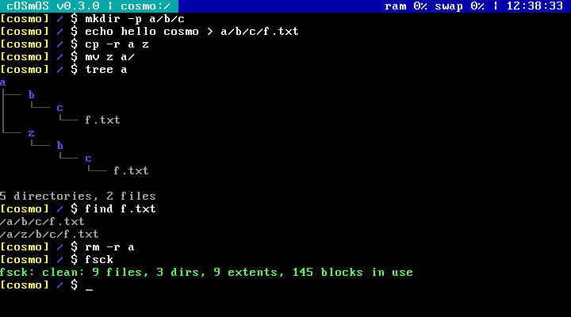

## Struktur Repository

```
src/
├── kernel-entrypoint.s, kernel.c, linker.ld, menu.lst
├── user-linker.ld, user-linker-flat.ld   linker program user (ELF/CEX dan flat)
├── process/      process.c (PCB, create, terminate), scheduler.c, context-switch.s, exec.c (loader), pipe.c
├── cpu/          gdt (+ user segment, TSS), idt, interrupt (exception, IRQ, syscall), intsetup.s
├── memory/       paging.c (page directory per proses, frame allocator, clock), swap.c, kheap.c
├── kernel/       syscall.c, user.c (validasi pointer, init, crash), statusbar.c (status bar + taskbar), splash, panic
├── driver/       keyboard, disk (ATA), timer (PIT), mouse, speaker, rtc (CMOS), rtl8139, serial, pci, power
├── net/          net.c: Ethernet, ARP, IPv4, ICMP, UDP socket
├── graphics/     graphics.c (BGA), compositor.c (window compositor)
├── text/         framebuffer, console (scrollback), font8x16
├── filesystem/   ext2.c, cosmofs.c, vfs.c
├── stdlib/       string.c, format.c, heap.c (dipakai kernel dan user)
├── user/         crt0.s, ulib (syscall, malloc, printf, net), gfx (canvas window), shlib.c (output, path),
│                 shell.c, cmd_*.c (perintah), cmd_table.c, bin/command.c (pembungkus /bin), apps/*.c
├── external/     inserter, cosmofs-tool, elf2cex (program host)
└── header/       header semua modul (process/, net/, graphics/, ...)
rootfs/           file contoh untuk root (README.txt, docs/, scripts/*.sh termasuk m4demo.sh)
tools/            gen_font.py, video2cvid.py
test/             unit test host (make test)
docs/             screenshot dan maskot
```

## Maskot Kelompok

<p align="center"></p>

**Cosmo**, planet kecil bercincin yang menjadi logo boot splash cOSmOS.

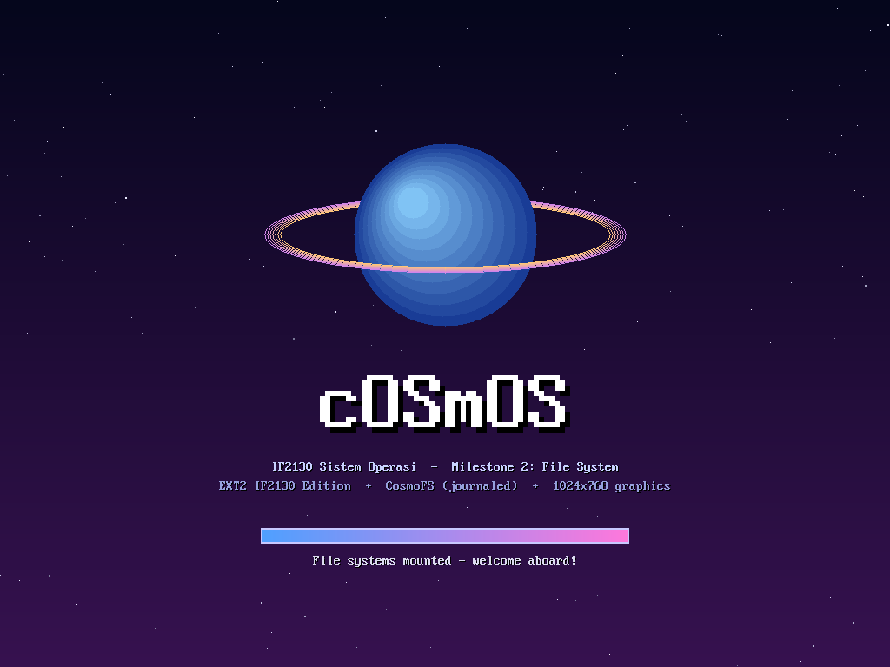

## Kredit dan Referensi

- IF2130 Book (Edisi 4), Hub, dan dokumen Bonus 2026 oleh Asisten Lab Sister ITB. Template repository: [os-template-2026](https://github.com/Nathan-Marpaung/os-template-2026).
- Glyph font 8x16: `u_vga16.bdf`, Copyright (c) 2000, 2001 Dmitry Bolkhovityanov (lisensi MIT-style), dari paket console-setup (`tools/gen_font.py`).
- [OSDev Wiki](https://wiki.osdev.org/): Paging, Higher Half Kernel, TSS, Context Switching, PIT, CMOS, ATA PIO, Bochs VBE Extensions, PS/2 Mouse, RTL8139, ELF.
- [Operating Systems: Three Easy Pieces](https://pages.cs.wisc.edu/~remzi/OSTEP/) (process, scheduling) dan sumber [xv6](https://course.ccs.neu.edu/cs3650/unix-xv6/HTML/).
- System V ABI i386 (layout stack awal `argc`/`argv`/`envp`), RFC 791 (IPv4), RFC 792 (ICMP), RFC 768 (UDP), RFC 826 (ARP), RFC 1035 (DNS).
- Russ Cox, [Regular Expression Matching: the Virtual Machine Approach](https://swtch.com/~rsc/regexp/regexp2.html) (Pike VM untuk `grep`).
- Howard Hinnant, [chrono-compatible low-level date algorithms](https://howardhinnant.github.io/date_algorithms.html).
- [The Second Extended File System](https://www.nongnu.org/ext2-doc/ext2.html) oleh Dave Poirier.
- Dikerjakan dengan bantuan Claude Code (Anthropic); proses dan analisisnya dicatat di jurnal kelompok.
